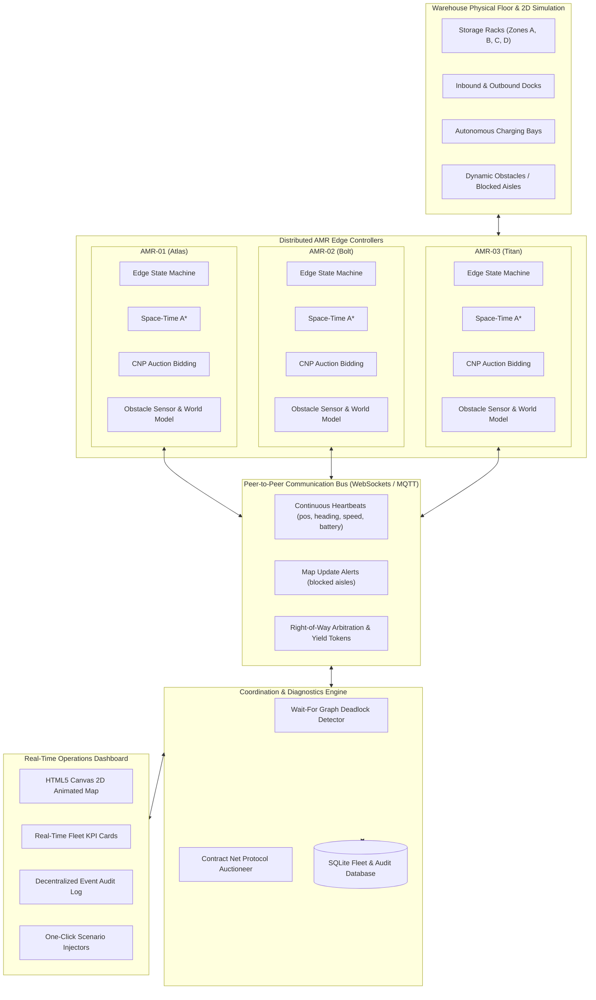

# Edge-AI Based Distributed Fleet Coordination for AMRs in Smart Warehouses

An intelligent, decentralized multi-robot coordination system designed for Autonomous Mobile Robots (AMRs) operating inside smart logistics warehouses.

This project demonstrates how multiple robots communicate peer-to-peer, negotiate movement priorities, avoid collisions, resolve deadlocks, and dynamically allocate tasks using **Edge AI** and **Space-Time Coordination** without relying on a single point of failure or centralized bottleneck.

---

## 📑 Table of Contents

1. [Key Features](#-key-features)
2. [System Architecture](#-system-architecture)
3. [Edge-AI vs Traditional Algorithms](#-edge-ai-vs-traditional-algorithms)
4. [Project Directory Structure](#-project-directory-structure)
5. [Prerequisites & Quick Start](#-prerequisites--quick-start)
   - [Option A: Instant Launch with Node.js (Ready Out of the Box)](#option-a-instant-launch-with-nodejs-ready-out-of-the-box)
   - [Option B: Running with Python FastAPI & SQLite Backend](#option-b-running-with-python-fastapi--sqlite-backend)
6. [Interactive Fleet Dashboard Guide](#-interactive-fleet-dashboard-guide)
7. [The 6 Real-World Demonstration Scenarios](#-the-6-real-world-demonstration-scenarios)
8. [Automated Verification & Testing](#-automated-verification--testing)
9. [Database Schema (SQLite)](#-database-schema-sqlite)
10. [Future Physical AMR & ROS 2 Roadmap](#-future-physical-amr--ros-2-roadmap)

---

## 🚀 Key Features

- **Multi-Robot Peer-to-Peer Communication:** Continuous heartbeat broadcast exchanging robot ID, coordinates $(x, y)$, heading angle, speed, battery level, current task, and intended next waypoints.
- **Space-Time Cooperative A\* (Time-Expanded A\*):** Calculates 3D $(x, y, t)$ collision-free trajectories that mathematically prevent both **Vertex Collisions** (two AMRs on same cell at same tick) and **Edge Swap Collisions** (two AMRs passing each other in opposite directions across the same edge).
- **Decentralized Collision Avoidance:** Proximity radar circles evaluate head-on and intersection conflicts locally on each AMR. Distributed right-of-way arbitration rules determine who yields based on task urgency, battery state, and distance to destination.
- **Deadlock Detection & Resolution:** Dynamic **Wait-For Graph (WFG)** analyzes robot waiting dependencies. Detects directed cycles (e.g., $R_1 \to R_2 \to R_3 \to R_1$) and automatically commands the optimal victim robot to evacuate into a safe warehouse siding/alcove.
- **Dynamic Task Allocation (Contract Net Protocol):** When a warehouse logistics task arrives, edge agents submit competitive bids using a multi-criteria utility cost function ($Cost = w_1 \cdot \text{distance} + w_2 \cdot \text{battery} + w_3 \cdot \text{workload} - w_4 \cdot \text{urgency}$).
- **Blocked-Aisle LiDAR Detection & Dynamic Rerouting:** Simulates forward edge sensors. When an unexpected blockage is encountered, the discovering AMR marks it on its local map, broadcasts an alert to peer AMRs, and all affected robots dynamically calculate alternative corridors around the obstruction.
- **Battery Autonomy & Dynamic Thresholds:** Instead of static low-battery percentages, Edge AI computes distance-aware return thresholds ($T = \text{dist} \times \text{drain} \times 1.5 + \text{buffer}$). Below this threshold, an AMR bids $\infty$ to reject new tasks, hands off active cargo, and navigates autonomously to the nearest charging bay.
- **Real-Time 2D Warehouse Simulation & Fleet HUD:** HTML5 Canvas rendering with smooth continuous linear interpolation (lerp), visual rack structures, charging pads, directional heading arrows, path ribbons, status LED rings, and interactive obstacle toggling.

---

## 🏛 System Architecture



---

## 🧠 Edge-AI vs Traditional Algorithms

To ensure transparent and predictable robotics operations, the project explicitly separates deterministic algorithms from edge-AI heuristics:

| Capability | Classical Deterministic Algorithm | Edge-AI Decision Intelligence |
| :--- | :--- | :--- |
| **Path Planning** | **A\* / Dijkstra / Space-Time A\*:** Exhaustive graph search over $(x, y, t)$ grid with Manhattan heuristic. | **Adaptive Corridor Selection:** Evaluates historical traffic bottlenecks and edge congestion before initiating search. |
| **Task Allocation** | Fixed round-robin assignment or nearest-robot heuristic. | **Multi-Criteria Contract Net Protocol (CNP):** Edge bidding function factoring nonlinear battery depletion, payload inertia, and task priority preemption. |
| **Speed Regulation** | Static binary speeds ($0$ or $V_{\max}$). | **Congestion Density Index:** Modulates cruising speed smoothly based on inverse-square distance of neighboring AMRs to eliminate stop-and-go energy waste. |
| **Deadlock Handling** | **Tarjan's DFS Cycle Detection:** Mathematically identifies closed directed cycles in the Wait-For Graph. | **Victim Selection & Retreat Planning:** Evaluates AMR battery margins and task criticalities to select the best agent to pull into a siding. |
| **Battery Return** | Static threshold (e.g. fixed at 20%). | **Dynamic Battery Forecaster:** Computes energy needed for distance, 90° turns, and cargo weight to determine adaptive charging trigger. |

---

## 📂 Project Directory Structure

```text
edge-amr-fleet/
├── config.py                      # Warehouse grid dimensions, speeds, battery settings, AI weights
├── requirements.txt               # Python backend dependencies (FastAPI, Uvicorn, WebSockets)
├── package.json                   # Node.js runner scripts
├── README.md                      # Comprehensive system guide and setup instructions
├── backend/
│   ├── __init__.py
│   ├── main.py                    # FastAPI server, REST API endpoints, WebSocket broadcaster
│   ├── database.py                # SQLite database persistence (robots, tasks, events, telemetry)
│   ├── models.py                  # Dataclasses and Pydantic models (RobotState, Task, Heartbeat)
│   ├── algorithms/
│   │   ├── __init__.py
│   │   ├── a_star.py              # 2D A* and Dijkstra pathfinding
│   │   ├── space_time_a_star.py   # Cooperative Space-Time 3D (x, y, t) reservation table
│   │   ├── collision_avoidance.py # Proximity conflict detection & Right-of-Way arbitration
│   │   ├── deadlock_detector.py   # Wait-For Graph (WFG) cycle detection & retreat resolver
│   │   └── task_allocator.py      # Contract Net Protocol (CNP) multi-agent auction engine
│   ├── edge/
│   │   ├── __init__.py
│   │   ├── amr_agent.py           # AMR Edge Agent (FSM, sensor simulation, local world model)
│   │   └── edge_ai_decision.py    # Energy consumption forecaster, congestion density index
│   ├── warehouse/
│   │   ├── __init__.py
│   │   ├── warehouse_map.py       # 2D Warehouse layout (racks, aisles, docks, charging pads)
│   │   └── fleet_manager.py       # Fleet coordination harness & scenario injector
│   └── tests/
│       ├── __init__.py
│       ├── test_pathfinding.py    # Unit tests for A* and Space-Time A*
│       ├── test_deadlock.py       # Unit tests for WFG cycle detection & recovery
│       ├── test_task_allocation.py# Unit tests for CNP auctions and battery constraints
│       ├── test_simulation.py     # Unit tests for fleet step execution and scenario loading
│       └── verify_suite.js        # Automated 27-point Node.js verification test suite
└── frontend/
    ├── index.html                 # Fleet Monitoring Dashboard & 2D Warehouse UI
    ├── node_server.js             # Zero-dependency Node.js HTTP/WebSocket server & simulation engine
    ├── css/
    │   └── styles.css             # Modern dark-mode cyber-industrial theme
    └── js/
        ├── warehouse_canvas.js    # HTML5 Canvas 2D renderer with continuous lerp interpolation
        ├── telemetry_dashboard.js # Real-time KPI cards, battery meters, live event audit log
        ├── websocket_client.js    # WebSocket connection with auto-reconnect & REST fallback
        └── scenarios.js           # Scenario handlers and interactive task dispatcher
```

---

## ⚡ Prerequisites & Quick Start

You can run this project on your Windows laptop using either **Node.js** (instant, zero installation required) or **Python FastAPI**.

### Option A: Instant Launch with Node.js (Ready Out of the Box)

Node.js (v24) is already installed on your system. `frontend/node_server.js` is a zero-dependency server that uses built-in Node.js modules:

1. Open PowerShell or Command Prompt.
2. Navigate to the project directory:
   ```powershell
   cd C:\Users\prana\.gemini\antigravity\scratch\edge-amr-fleet
   ```
3. Start the server:
   ```powershell
   node frontend/node_server.js
   ```
   *(Or run `npm start`)*
4. Open your browser and navigate to:
   ```text
   http://127.0.0.1:8000
   ```
5. Click **▶ Start** or any of the **Scenario Buttons** (1 to 6) to watch the fleet in action!

---

### Option B: Running with Python FastAPI & SQLite Backend

If you wish to run the Python backend:

#### 1. Install Python 3.11 or 3.12 (if not already installed)
Open PowerShell and run:
```powershell
winget install Python.Python.3.12
```
*Or download the installer directly from [python.org](https://www.python.org/downloads/). During installation, check the box **"Add python.exe to PATH"**.*

#### 2. Create and Activate a Virtual Environment
```powershell
cd C:\Users\prana\.gemini\antigravity\scratch\edge-amr-fleet
python -m venv venv
.\venv\Scripts\Activate.ps1
```

#### 3. Install Dependencies
```powershell
pip install -r requirements.txt
```

#### 4. Run the Automated Python Test Suite
```powershell
pytest backend/tests/
```

#### 5. Launch the FastAPI Fleet Server
```powershell
uvicorn backend.main:app --host 127.0.0.1 --port 8000 --reload
```
Open `http://127.0.0.1:8000` in your web browser.

---

## 🖥 Interactive Fleet Dashboard Guide

1. **Warehouse Canvas (Left Pane):**
   - **Racks:** Slate blue rectangular structures with inner shelf divider lines.
   - **Inbound Docks (1-3):** Blue glowing bays on the left where cargo originates.
   - **Outbound Stations (1-3):** Purple glowing bays on the right where cargo is delivered.
   - **Charging Bays (1-3):** Yellow glowing pads at top rows $(6, 0)$, $(12, 0)$, and $(18, 0)$.
   - **AMRs:** Circular robots with directional heading arrows, ID tags, battery gauges, and dashed path ribbons.
   - **Interactive Blocked Aisle:** Click the **"⛔ Click Map to Block Aisle"** button, then click on any open aisle cell to drop a dynamic roadblock. Watch the AMRs detect it and reroute!

2. **Fleet Telemetry (Right Pane):**
   - Shows live position, battery progress bars (green > 50%, amber 25-50%, red < 25%), current mission, speed, and status pill (**MOVING**, **WAITING**, **YIELDING**, **CHARGING**, **REROUTING**).

3. **Task Dispatcher Form:**
   - Choose a pickup dock, delivery destination, and priority level (**Low**, **Normal**, **High**, **URGENT**).
   - Click **"📢 Announce Task for Edge Auction"** to trigger a real-time Contract Net Protocol auction.

4. **Decentralized Event Audit Log:**
   - Displays real-time entries with timestamps whenever:
     - A task is announced or awarded.
     - A proximity conflict is negotiated and a right-of-way decision is made.
     - A deadlock cycle is broken by an evacuation maneuver.
     - A blocked aisle is detected by onboard sensors.
     - An AMR redirects to a charging bay.

---

## 🎬 The 6 Real-World Demonstration Scenarios

Click the scenario buttons on the dashboard to test each specific multi-robot coordination challenge:

### Scenario 1: Multi-Robot Simultaneous Tasks
- **What happens:** 3 AMRs receive independent pickup-and-delivery missions across different warehouse aisles simultaneously.
- **What to observe:** Space-Time Cooperative A\* ensures all 3 AMRs cruise without cross-intersection interference or trajectory clipping.

### Scenario 2: Head-On Narrow Aisle Conflict
- **What happens:** AMR-01 (Atlas) and AMR-02 (Bolt) enter the single-lane narrow aisle in Column 11 from opposite ends, traveling directly toward each other.
- **What to observe:** Proximity sensors detect head-on conflict ($\vec{v}_1 \cdot \vec{v}_2 < 0$). Right-of-Way arbitration runs: the AMR with lower priority yields and waits or steps aside into an adjacent alcove while the winning AMR passes safely.

### Scenario 3: 3-Way Deadlock Detection & Resolution
- **What happens:** 3 AMRs are placed at a tight circular intersection where Robot A waits for B, B waits for C, and C waits for A.
- **What to observe:** The **Wait-For Graph (WFG)** detects a circular dependency cycle (`AMR-01 -> AMR-02 -> AMR-03 -> AMR-01`). The deadlock victim selector picks the robot with the most maneuverable battery reserve, which automatically executes a retreat maneuver into a nearby siding, breaking the deadlock.

### Scenario 4: Blocked-Aisle Dynamic Rerouting & Peer Broadcast
- **What happens:** A dynamic obstacle (e.g. fallen freight or debris) is injected into the central transit corridor at $(10, 7)$.
- **What to observe:** As AMR-01 approaches, its forward sensor detects the blockage. It marks the cell as impassable, broadcasts a `MAP_UPDATE_ALERT` to all peer AMRs, and dynamically recalculates an alternative route via the upper perimeter corridor.

### Scenario 5: Low Battery Autonomous Re-docking & Task Handoff
- **What happens:** AMR-02's battery drops to 18% (below the safety threshold) while holding an active delivery task.
- **What to observe:** AMR-02 immediately hands off its pending mission back to the auction pool (awarded to peer AMR-01) and autonomously routes itself to **Charging Bay 2**, where it recharges back to 100%.

### Scenario 6: Urgent VIP Task Preemption
- **What happens:** While AMRs are performing routine low-priority tasks, an **URGENT (VIP Cargo Preemption)** task is injected.
- **What to observe:** The Contract Net Protocol auction weights the urgent task heavily. The nearest capable AMR preempts its low-priority assignment and immediately diverts to fulfill the VIP mission.

---

## 🧪 Automated Verification & Testing

The project includes both a Python pytest suite and an automated Node.js test suite.

To run the 27-point Node test suite:
```powershell
node backend/tests/verify_suite.js
```

**Verification Results:**
```text
=================================================================
  RUNNING COMPLETE AMR FLEET COORDINATION TEST SUITE
=================================================================

[TEST GROUP 1: Warehouse Topology & Walkability]
  ✅ PASS: Corridor (1, 1) is walkable
  ✅ PASS: Rack at (4, 2) is non-walkable obstacle
  ✅ PASS: Structural pillar at (6, 7) is non-walkable

[TEST GROUP 2: A* Intelligent Path Planning]
  ✅ PASS: A* finds straight path in corridor (length 5)
  ✅ PASS: Path starts at (1, 1)
  ✅ PASS: Path terminates at goal (1, 5)
  ✅ PASS: A* finds path around Storage Rack Block Zone A
  ✅ PASS: A* path does not collide with or pass through racks

[TEST GROUP 3: Distributed Contract Net Protocol]
  ✅ PASS: Task initialized in PENDING auction pool
  ✅ PASS: Task awarded to winning AMR bidder
  ✅ PASS: Task assigned to AMR-01

[TEST GROUP 4: Dynamic Obstacle & Blocked Aisle]
  ✅ PASS: Aisle cell (10, 7) toggled to BLOCKED
  ✅ PASS: Blocked cell is recognized as non-walkable
  ✅ PASS: Aisle cell (10, 7) toggled back to CLEARED
  ✅ PASS: Cleared cell is walkable again

[TEST GROUP 5: Demonstration Scenarios 1 to 6]
  ✅ PASS: Scenario 1 loaded and simulation running
  ✅ PASS: Scenario 1 logged start event: "Scenario 1 Loaded"
  ✅ PASS: Scenario 2 loaded and simulation running
  ✅ PASS: Scenario 2 logged start event: "Scenario 2 Loaded"
  ✅ PASS: Scenario 3 loaded and simulation running
  ✅ PASS: Scenario 3 logged start event: "3-Way Deadlock Cycle Resolved"
  ✅ PASS: Scenario 4 loaded and simulation running
  ✅ PASS: Scenario 4 logged start event: "Scenario 4 Loaded"
  ✅ PASS: Scenario 5 loaded and simulation running
  ✅ PASS: Scenario 5 logged start event: "Scenario 5 Loaded"
  ✅ PASS: Scenario 6 loaded and simulation running
  ✅ PASS: Scenario 6 logged start event: "Scenario 6 Loaded"
=================================================================
  TEST RESULTS: 27 PASSED, 0 FAILED
=================================================================
```

---

## 🗄 Database Schema (SQLite)

The SQLite database (`fleet_warehouse.db`) is automatically initialized and maintained:

1. **`robots`**: Tracks `id`, `name`, `color`, `grid_x`, `grid_y`, `battery`, `status`, `total_distance`, and `tasks_completed`.
2. **`tasks`**: Stores `id`, `description`, `pickup_x`, `pickup_y`, `dropoff_x`, `dropoff_y`, `priority`, `status`, `assigned_robot_id`, `created_at`, and `completed_at`.
3. **`event_logs`**: Permanent audit trail of `COLLISION_AVOIDED`, `DEADLOCK_RESOLVED`, `TASK_AWARDED`, `AISLE_BLOCKED`, and `BATTERY_LOW` events.
4. **`telemetry_history`**: Periodic snapshots of active, idle, waiting, and charging robot counts for performance analytics.

---

## 🔮 Future Physical AMR & ROS 2 Roadmap

The system is architected with clear boundaries to enable plug-and-play migration to real physical hardware:

- **ROS 2 Humble / Iron Integration:** Each `AMREdgeAgent` can be mapped directly to a ROS 2 node.
  - Heartbeats $\to$ ROS 2 `/amr_id/robot_pose` and `/amr_id/battery_state` topics.
  - Path Waypoints $\to$ `nav2_msgs/action/NavigateToPose` or `nav2_msgs/action/FollowWaypoints`.
  - Collision Proximity $\to$ LiDAR laser scan `/scan` topic costmaps.
- **Physical Microcontrollers (ESP32 / Raspberry Pi 5):** The lightweight Edge-AI bid calculation and FSM logic require minimal RAM (< 15 MB) and can execute directly on low-power onboard SBCs.
- **MQTT / Zenoh Broker:** Replace WebSockets with industrial MQTT or Zenoh for wireless multi-robot fleet meshing across wide factory floors.
